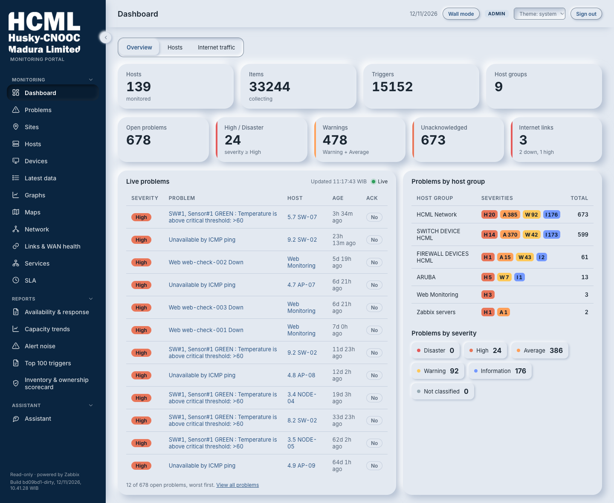
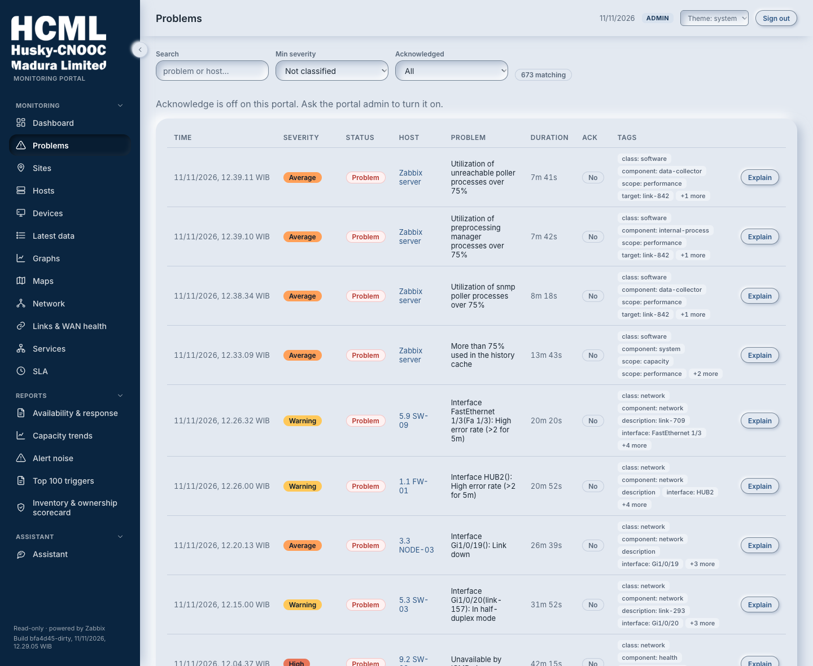
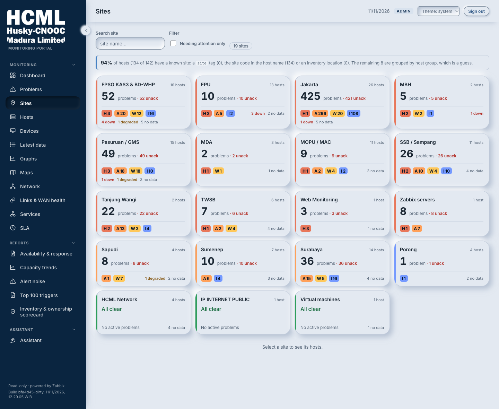
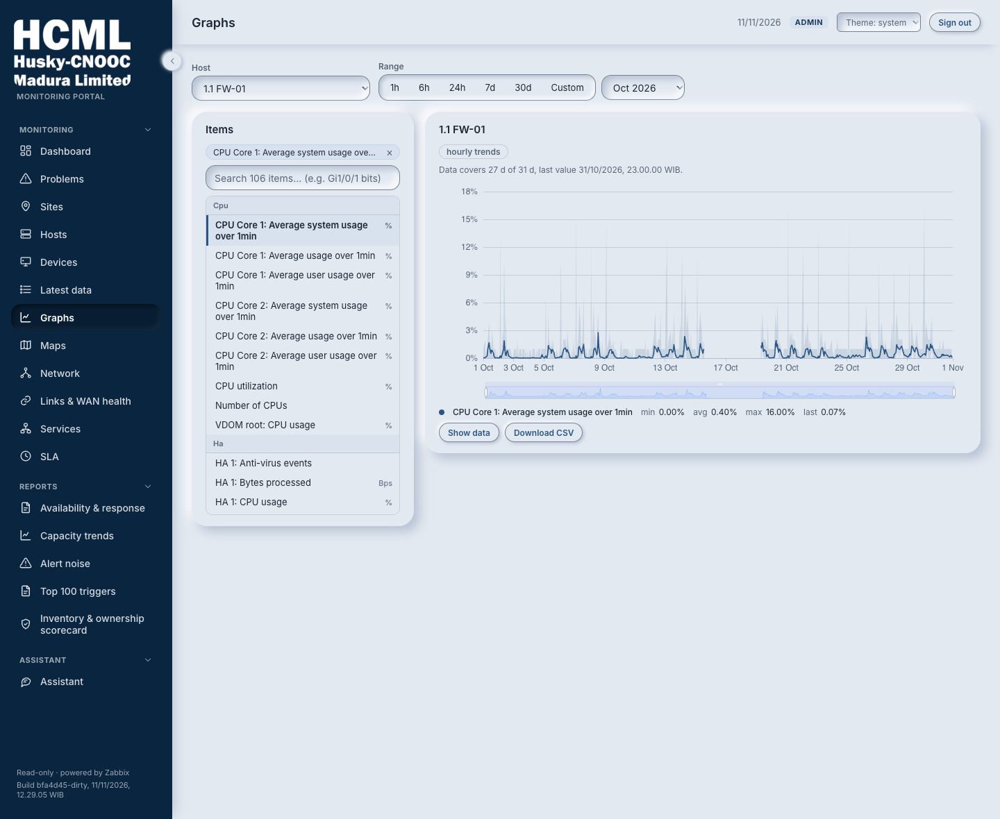

# HCML Monitoring Portal: `hcml-portal-ollama`

A web portal that shows the state of HCML's servers, network devices and WAN links, grouped by
site. HCML is Husky-CNOOC Madura Limited. The portal reads everything from HCML's Zabbix monitoring
system and has no database of its own.

Zabbix already collects every measurement, and it stays the place to set up hosts, items and
triggers. Its own screens list things device by device. This portal regroups the same data by site
and by service, answers "is anything wrong right now?", and works out the monthly availability
figure (the SLA), which HCML's Zabbix has no services configured to produce.

It changes nothing in Zabbix except one thing: an operator can acknowledge or close a problem. That
single write uses its own Zabbix token. Leave that token blank and the portal cannot write at all.

An optional assistant can explain problems in plain language. **In this copy the assistant runs on
`qwen3:8b`, a model on this computer, so no question and no summary of the estate leaves the machine.** That is the
reason this copy exists. (It never emails a report either: its compose file passes no mail settings.) The sibling copy, `hcml-portal`, runs the same code against Claude, a model
hosted by Anthropic: see [The two copies of this portal](#the-two-copies-of-this-portal).

New to the abbreviations? The [Glossary](#glossary) at the end explains the ten this file leans on and points to the full lists.

### What it looks like









Host names, addresses and interface descriptions in these images are stand-ins; the counts,
severities, times and site names are real. The Dashboard's Hosts view, the Devices page,
Show data with its CSV download, the dark theme, the narrow-screen layout and the Network page (all taken from
HCML's own Zabbix on 11 November, with the names replaced) are in
[`docs/screenshots/`](docs/screenshots/README.md), with how the names were replaced.

### How the parts connect

```
 Browser (React) ──HTTP+SSE──► BFF (Fastify, holds tokens, caches) ──JSON-RPC──► Zabbix API
                                            │
                                            └──── HTTP ────► Ollama on this host
                                                             qwen3:8b · never off-box
```

The first arrow is plain HTTP on this computer's loopback address: nginx listens on port 8080 inside
its container and Docker publishes it on `127.0.0.1` only. Nothing in this repository terminates
TLS, so before the portal is reached from another machine, put TLS in front of it:
[`docs/operations/tls.md`](docs/operations/tls.md).

Read it left to right. Your browser only ever talks to the portal's own server, the BFF. The BFF
holds the Zabbix credentials, so the browser never sees them. It asks Zabbix for data in Zabbix's
JSON-RPC format, keeps recent answers for a short time so it does not ask twice, and sends the
result on. The live Dashboard keeps one connection open (SSE) so updates arrive without a reload.
The branch underneath is the assistant: the BFF sends its questions to Ollama on this same computer,
and the answers go nowhere else.

Nine flows are drawn in that same one-line style (a page load, the live Dashboard, the request
pipeline, the cache, sign-in, where a number comes from, both AI paths and the one write) in
[`docs/flow/README.md`](docs/flow/README.md#the-nine-flows-one-line-each).

### Contents

- [What it looks like](#what-it-looks-like): the main pages, as images
- [Tech stack](#tech-stack): what it is built with, and why
- [Layout](#layout): the folders, and where the handbook describes every file
- [Quick start (local dev)](#quick-start-local-dev): run it on your own machine, model included
- [Deploy (Docker, next to Zabbix)](#deploy-docker-next-to-zabbix): run it in containers
- [Usage](#usage): signing in, the 19 pages, and where the rest is described
- [Configuration](#configuration): every setting the BFF reads
- [Testing](#testing)
- [Milestones](#milestones)
- [Known gaps](#known-gaps)
- [Related docs](#related-docs)
- [Glossary](#glossary)

---

## Tech stack

41 direct dependencies in total, 18 in the BFF and 23 in the web app, of which 14 ship: the
rest are build, test and lint tools. The two heaviest categories
of dependency a project like this usually carries are deliberately absent: there is no ORM or
database driver (the portal owns no data: everything comes from Zabbix over the API) and no
component library (the UI is plain CSS, so the app runs with zero extra setup).

### BFF: `server/`

| Piece | Version | What it does here |
|---|---|---|
| Node | 24 LTS (`node:24.22-alpine`, pinned by digest) | Picked for native `fetch` and `AbortSignal.timeout`. The Zabbix client (under 200 lines) and the local-model client are written straight onto them, so there is no HTTP-client dependency at all |
| TypeScript | ^5.9 | ESM throughout: `"type": "module"`, `NodeNext` resolution, ES2022 target, `strict: true`. Tests live under `src/` (same imports as the code) but are excluded from the shipped `dist/` and typechecked by a second config, `tsconfig.test.json` |
| Fastify | ^5.12 | Plugin-scoped hooks are the reason the RBAC guard is a single `onRequest` at the root rather than a check repeated in every handler. 24 route modules register onto it → 45 endpoints, and `security/auth.ts` and `http/health.ts` add the other six: `/api/auth/login`, `/api/auth/me`, `/api/auth/refresh`, `/api/auth/logout`, `/api/health` and `/api/ready` |
| `@fastify/helmet` | ^13.1 | Security headers. CSP is off: nginx serves the SPA, and Fastify serves data, not pages: JSON, the event streams and the report files, which download as attachments |
| `@fastify/cors` | ^11.4 | Exactly one allowed origin, from `WEB_ORIGIN` |
| `@fastify/jwt` | ^10.2 | Signs the login token (12 hours unless `SESSION_HOURS` says otherwise) and reads it from the session cookie, or from an `Authorization: Bearer` header for scripts. No route takes it in the query string; `logging.ts` still redacts a `?token=` sent by a page opened before the cookie |
| `@fastify/cookie` | ^11.1 | Sets the httpOnly, `SameSite=Strict` session cookie the token travels in, so no script on the page can read it ([ADR-0010](docs/architecture/adr/0010-session-cookie.md)) |
| `@fastify/rate-limit` | ^11.2 | Per-IP cap, with `/api/stream` and `/api/health` exempt, so a NOC wall that polls does not throttle itself, and sign-out, so a spent allowance never leaves the cookie working. The stream is capped instead: `STREAM_MAX_CLIENTS` screens in all and `STREAM_MAX_PER_USER` for one user, past which it answers 429. `POST /api/auth/login` has a tighter limit of its own: 10 attempts a minute, and a lock after 10 failures in a row that grows from 1 to 5 minutes |
| `nodemailer` | ^10.3 | Sends the emailed SLA report through the SMTP server the `MAIL_` settings name, over TLS or STARTTLS. The first library added for a feature, and it has none of its own ([ADR-0014](docs/architecture/adr/0014-email-the-sla-report-through-smtp.md)) |
| `dotenv` | ^16.4 | `.env` in dev. In Docker, Compose passes the environment directly |
| `@anthropic-ai/sdk` | ^0.124 | Installed but unused in this copy. It is the hosted backend of `ai.ts`, which this repo never selects; because the source tree is shared it is still imported at module load and still ships in the image. The backend this copy *does* use (OpenAI-compatible and Ollama-native) is hand-rolled on `fetch`, no SDK |
| Report writers | not a package | `src/export/` writes the monthly SLA report as a PDF and as an Excel workbook, on request, with Node's built-in `zlib` and `crypto` modules and no PDF or spreadsheet library. ADR-0011 (`docs/architecture/adr/0011-build-the-sla-report-files-in-the-bff.md`) has the trade-off |
| Vitest | ^5.0 | 3097 tests in 122 files, all green (12 Nov 2026, run in both copies). Zabbix is mocked at `src/clients/zabbix.ts` (the single module all API traffic funnels through) so the suite needs no live instance and no model |
| tsx | ^4.16 | `npm run dev` watch mode, and the standalone checks under `scripts/`. Production runs plain `node dist/index.js` |
| ESLint (with `@eslint/js`, `typescript-eslint` and `globals`) | ^10.13 | Dev only, never shipped. `npm run lint` in `server/`: the recommended rules of ESLint and of typescript-eslint, and no warning allowed. The first run, on 19 October 2026, found 22 findings; the eight `eslint-disable` lines left each say why |

Compression (`compress.ts`, gzip/brotli over `node:zlib`) and query validation (`validate.ts`) are
also written rather than installed, `/api/problems` alone is ~446 kB uncompressed and polled every
few seconds.

### Web: `web/`

| Piece | Version | What it does here |
|---|---|---|
| React | ^18.3 | The library every screen of the web app is written in |
| Vite | ^8.3 | Dev server proxies `/bff` → `:4000`, so dev and prod hit the same paths. `strictPort: true`, and both the port and the BFF URL are overridable: without that, a second portal silently sliding to `:5174` would still be talking to the first one's BFF |
| `react-router-dom` | ^7.18 | All 19 pages are `lazy()`. The initial bundle is 222 kB JS + 58 kB CSS (73 kB of the JS gzipped); a page after that costs between 1 and 28 kB, the Dashboard being the largest, and the chart library (612 kB, 206 kB gzipped) loads only with a chart. Raw sizes of the 20 October build |
| ECharts + `echarts-for-react` | ^6.1 / ^3.0 | Registered selectively (line chart, grid, tooltip, legend, data zoom, canvas renderer) instead of the barrel, which pulls in roughly a megabyte of chart types nothing draws. Drawn with the `v5` theme ECharts 6 ships, so the parts the portal does not colour itself look as they did on 5.x. Imported only by `TimeSeriesChart`, so its 612 kB chunk loads on Graphs and Network and nowhere else |
| Custom CSS | not a package | One stylesheet in 20 numbered parts (`web/src/styles/`). HCML blue `#2B5584`, measured from the company logo, with Inter for text and IBM Plex Mono for IDs and figures. Light and dark from one set of CSS variables, per `DESIGN.md`. `scripts/css.check.mjs` checks it structurally, because Vite's build does not fail on an unclosed block; `scripts/tokens.check.mjs` computes the contrast of every pair and fails on a raw value |
| Hand-rolled, on purpose | not a package | `shared/hooks/useSSE.ts` over native `EventSource`; `shared/hooks/useAsync.ts` for server state, in place of a query library; `features/assistant/parseMarkdown.ts` in about 150 lines, because the assistant's answers are the only markdown in the app and a full renderer is a large attack surface for a small job |
| Vitest + Testing Library | ^5.0 / ^16.3 | 1844 tests in 119 files, run in jsdom: the sign-in return path, the CSRF header and 401 handling in `api/`, `useAsync`, `useSSE`, `useUrlState`, the wall highlight, the live list, `lib/time`, the report download buttons, the data-age and stale-copy notices, the CSV writer and the Assistant's chat storage. `npm test` in `web/` |
| ESLint | ^9.39 | `npm run lint` in `web/`: typescript-eslint, the two classic react-hooks rules and jsx-a11y's recommended set. On 9 because jsx-a11y does not support ESLint 10 yet |
| `openapi-typescript` | ^7.13 | Dev only, never shipped. `npm run gen:api` in `web/` turns `docs/api/openapi.yaml` into `web/src/generated/openapi.ts`. A test holds the app's hand-written types (`types/`) to those: a response schema that promises less than a page needs, or a kind the page cannot hold, fails `npm run typecheck` and names the place, such as `/api/hosts[].status` |

### Around it

| Piece | Version | What it does here |
|---|---|---|
| Zabbix | 7.0 | The only data source, read over JSON-RPC 2.0, never its database. Two tokens: read everywhere, write only for acknowledge/close |
| Ollama | native, on the host | Serves `qwen3:8b` (5.2 GB) at `:11434`. Not containerised: Docker Desktop on macOS cannot pass through the Metal GPU, so a containerised Ollama falls back to CPU. The BFF speaks Ollama's native `/api/chat` when it answers, because only that API accepts a context size and honours `keep_alive` |
| Docker Compose | not pinned | Two services, neither of them a datastore: `portal-bff` (Node, with a healthcheck on `/api/health` and `init: true`) and `portal-web` (nginx, which starts once the BFF is healthy) on `127.0.0.1:8082`. Both images are multi-stage and install with `npm ci` against a committed lockfile, so one commit builds the same twice |
| nginx | alpine | Serves the build and reverse-proxies `/bff`, with buffering off on the live stream and the assistant (SSE never arrives without it) and a 360 s read timeout elsewhere (480 s for explanations and for the monthly SLA and its download, an hour for the two live streams), a resolver so recreating the BFF alone does not leave `/bff` on 502, a one-year immutable cache on `/assets/`, and SPA fallback to `index.html`. It runs as an unprivileged user and listens on 8080 inside the container, with a read-only root filesystem (setup.md, section 23). It also adds security headers to the app's pages and files (the CSP, enforced since 14 October), gzips them, hides its version and writes `token=redacted` in its access log, for pages opened before the session cookie |

Deliberately not used: no ORM or database driver (the portal owns no data), no state-management
library (server state is two small hooks), no component library, no PDF or spreadsheet library (the
report writers are hand-rolled on `zlib` and `crypto`), and no second HTTP client: the Zabbix client
(under 200 lines) and model client (`ai.ts`, about 750) are both hand-rolled around native `fetch`.

### The two copies of this portal

This repo and its sibling, `myown/hcml-portal`, hold the *same source code*: `server/src`, `web/src`,
`tools/` and both `scripts/` folders match file for file. The whole difference is which model answers. There,
Claude hosted by Anthropic; here, `qwen3:8b` on this computer. That choice lives in the untracked
`.env` file, not in code, so the two are one program set up two ways rather than two programs.

Exactly 22 files differ between the two. All of them are settings, or documents written from
each copy's point of view. None of them is code:

- the two `.env` files and the two `.env.example` templates
- `docker-compose.yml` and `docs/api/openapi.yaml`, which name each copy's web port
- `docs/setup/11-running-deploying.md` and `19-authentication-rbac.md`, where three lines name the port and one the session cookie
- `README.md`, `docs/index.md`, and `AUDIT_REPORT.md` (each copy holds a different audit)
- `docs/architecture/adr/0005-*`, the decision record about the AI layer
- `docs/schema/CDM.mmd`, `ERD.mmd` and `PDM.mmd`, their three PDFs, and `docs/schema/README.md`
- `docs/flow/DataFlow.mmd`, its PDF, and `docs/flow/README.md`

The command that proves it, with the exclusions it needs, is in
[`docs/contributing.md`](docs/contributing.md), and `node tools/check/parity.check.mjs` runs the same
comparison with the 18 files that may differ (22 with the four `.env` files) named one by one.

---

## Layout

The code is in `server/` (the BFF) and `web/` (the browser app), each with its own `package.json`, lockfile and
Dockerfile. `tools/` holds the checkers that run against the repository, the writer of the handbook's generated
parts and the tools that read a running portal. `docs/` holds every document, `deploy/` the list of settings and
the rebuild and watcher scripts, and the root holds `docker-compose.yml`, `package.json` (`npm run verify` runs every
check from here), `CHANGELOG.md`, `tracker.md` and `setup.md`.

Every folder and file is described, from the code, in the handover handbook: [the repository
map](docs/handover/1-folders/repository-map.md) says what each one is for, and
[`docs/handover/README.md`](docs/handover/README.md) says where to start reading.

19 pages: Dashboard · Problems · Sites · Hosts · Devices · Graphs · Latest data · Maps · Network ·
Links & WAN health · Services · SLA · Availability & response · Capacity trends · Alert noise ·
Top 100 triggers · Inventory & ownership scorecard · Assistant · Login

---

## Quick start (local dev)

[`docs/getting-started.md`](docs/getting-started.md) takes this step by step, from the Zabbix token to the first
sign-in, and [Run it](docs/handover/4-working/run-it.md) says what a development machine needs. The short form:

### 0. Zabbix prep

Create a read-only role and user in Zabbix, with an API token for it. For acknowledge and close, make a second,
write-capable token, on purpose not the same one, so that no read path can ever write. The smoke test of a token,
and the `--resolve` form of it for HCML's office network, are in [`docs/getting-started.md`](docs/getting-started.md).

### 1. The model

This is the copy that runs its own. Install Ollama natively, not in a container (see the stack
table above):

```bash
brew install ollama
brew services start ollama
ollama pull qwen3:8b            # 5.2 GB
ollama list                     # qwen3:8b should be there
```

The portal works without it: leave `AI_BASE_URL` blank and every page still serves, only the
*Explain* buttons disappear and `/api/explain/*` returns 503.

### 2. Backend (BFF)

```bash
cd server
cp .env.example .env            # set ZBX_URL + ZABBIX_API_TOKEN; auth needs JWT_SECRET + PORTAL_PASS
npm install
npm run dev                     # http://127.0.0.1:4000
npm test                        # 3097 tests, no live Zabbix and no model needed

curl localhost:4000/api/health   # { ok, ts, ai, aiProvider, aiExternal, writeBack, defaults, ready: true|false } and, signed in, version, startedAt, build, streams, ready as an object
```

`/api/health` answers 200 even while Zabbix is down: `ok` means the process is up, and `ready` says whether it can read Zabbix (one `host.get` with a 2 s limit, cached 15 s). An anonymous caller gets `ready` as a plain `true` or `false`, so that a monitor needs no account (IN-47); a signed-in caller gets it as an object (`ready.ok` and, when that is false, `ready.zabbix` with the reason) together with `version`, `startedAt`, `build` and `streams` (every caller when sign-in is off). Outside Docker `build` reads `unknown`, since the commit and time come from Docker build arguments.

`server/.env.example` in this repo already selects the local backend, so copying it needs no
edit. It ships as:

```
AI_PROVIDER=openai-compatible
AI_BASE_URL=http://localhost:11434/v1   # host.docker.internal:11434 from a container
AI_MODEL=qwen3:8b
AI_TIMEOUT_MS=120000
```

The sibling repo `hcml-portal` ships the hosted block instead. Switching this copy to hosted needs
`AI_PROVIDER`, `AI_MODEL` and an Anthropic key all changed. `AI_PROVIDER` alone leaves `qwen3:8b`
pointed at the Anthropic API, and every *Explain* fails.

`AI_PROVIDER` accepts only `anthropic` or `openai-compatible`. Anything else, or leaving it empty,
falls back to `anthropic`. A typo such as `AI_PROVIDER=ollama` logs a warning at startup; an empty
value does not. Since 23 September 2026 this copy's `.env` files hold no Anthropic key, so that
fallback switches the AI features off instead of sending estate data to Anthropic. Keep it that way:
an Anthropic key does not belong in this repo. In Docker the fallback cannot happen at all: since
24 September this copy's `docker-compose.yml` fixes `AI_PROVIDER` to `openai-compatible` rather than
reading it from `.env`, and passes no Anthropic key to the container.

### 3. Frontend

```bash
cd web
npm install
npm run dev                     # http://localhost:5173 (proxies /bff → :4000)
```

### 4. Data

Point `ZBX_URL` at a Zabbix that already has hosts. An empty one makes for an empty portal. The demo-estate seed
scripts were removed on 21 September 2026: they wrote to whatever `ZBX_URL` pointed at, and their host names copied
HCML's real naming convention, so a collision would have hit a real host. An earlier note said they were recoverable
from commit `b4a4059`; they are not (checked on 21 September). A genuinely empty dev Zabbix would need them written
again.

---

## Deploy (Docker, next to Zabbix)

```bash
cp .env.example .env && chmod 600 .env   # ZBX_URL, ZABBIX_API_TOKEN, a real JWT_SECRET and PORTAL_PASS
docker compose up -d --build
# http://127.0.0.1:8082
```

`JWT_SECRET` and `PORTAL_PASS` have no default: Compose refuses to start without `JWT_SECRET`, and the BFF refuses to
start on a published or short secret or an empty or `admin` password. The rules are under
[Access control](#access-control). To have `/api/health` show which build is running, build with `BUILD_COMMIT` and
`BUILD_TIME` as Docker build arguments; they read `unknown` when left out.
`deploy/rebuild.sh` and `deploy/watch.sh` are run from `hcml-portal`. `rebuild.sh` rebuilds both portals (the rollback tags, those arguments, the wait for the containers to be healthy, the checks
an anonymous caller can make, and the tag that says what is live; `--dry-run` shows what it would do). `watch.sh --install` makes
this Mac check both portals every minute and show a notification when one stops answering, comes back, or has a container that
restarts in a loop; on a server, run `--once` from a timer.
[Deploy, rebuild and roll back](docs/handover/4-working/deploy-rebuild-rollback.md) has the steps, and
[Operations](docs/handover/3-integrations/operations.md) says what the containers do on a stop.

`8082`, not `8081`: the sibling portal keeps `8081`, and with both on one port the second container
can never start. Override with `WEB_PORT`, and keep `WEB_ORIGIN` in step with it.

Reaching the model from the container. Ollama runs on the host, so `AI_BASE_URL` must be
`http://host.docker.internal:11434/v1`, because `localhost` inside the container is the container.
`docker-compose.yml` uses that address when the root `.env` leaves `AI_BASE_URL` unset or empty. This
is the same trick `ZBX_URL` uses to reach Zabbix.

Reaching Zabbix. The portals read HCML's Zabbix: `ZBX_URL` defaults to
`https://zabbix.hcml.co.id/zabbix/api_jsonrpc.php`. From HCML's office network that name leads to a
Zero Trust gateway that refuses the portal, so `docker-compose.override.yml`, which stays on the
machine and out of git, maps the name to Zabbix's LAN address; the certificate is still checked
against the name. HCML's Zabbix takes 20 to 100 s on most pages and 256 s on the Capacity report, so
one read may take 300 s (`ZABBIX_TIMEOUT_MS`) and a page 330 s. The steps are in
[docs/operations/after-a-restart.md](docs/operations/after-a-restart.md).

---

## Usage

Everything above gets the portal running. This section is what it is *for*. The handbook's part for everyone explains
every page in plain words, with screenshots: [The pages](docs/handover/0-everyone/the-pages.md). The step-by-step first
run (Zabbix token, smoke test, first login) is in [`docs/getting-started.md`](docs/getting-started.md).

### Signing in

There is no user table. Users come from the environment: `PORTAL_USERS` as comma-separated
`name:password:role` triples, or `PORTAL_USER`/`PORTAL_PASS` as the single-admin shorthand. A
successful login gives the browser a JWT valid for 12 hours by default (`SESSION_HOURS`), in a cookie named by `SESSION_COOKIE`: `hcml_session_ollama` in this copy's Docker stack, `hcml_session` when unset. The
cookie is httpOnly, so no script on the page can read it, and `SameSite=Strict`, so other sites cannot make the browser
send it. An open portal renews its own token an hour before it runs out, so a wall screen stays signed in, and every
request looks the user up again, so removing a user or changing a role takes effect at once.
[Sign-in](docs/handover/3-integrations/sign-in.md) follows one sign-in from end to end, and
[ADR-0010](docs/architecture/adr/0010-session-cookie.md) and
[ADR-0009](docs/architecture/adr/0009-renew-an-open-portals-sign-in.md) have the trade-offs.

Cookies ignore ports, so this portal on 8082 and hcml-portal on 8081 need different cookie names, or
signing in to one signs you out of the other. That is why `docker-compose.yml` sets
`hcml_session_ollama` here. Under `npm run dev` both default to `hcml_session`; set `SESSION_COOKIE`
in `server/.env` to run both at once.

With `AUTH_ENABLED=false`, an opt-in for local work (the default is `true`), there is no login at
all and every caller is treated as `admin`.

Four roles, and the BFF is what enforces them:

| Role | Can reach |
|---|---|
| `viewer` | Everything not listed below. Unmatched routes require viewer, so a new route is protected by default |
| `wall` | …plus `/api/links` and `/api/net/*`, to read only: the account of a NOC wall screen, which shows the internet traffic meters and never acknowledges |
| `operator` | …plus the acknowledge write |
| `admin` | …plus `/api/reports/inventory`, emailing the SLA report (`/api/sli/email`) and the monthly send (`/api/sli/schedule`); the last two are off in this copy, which passes no mail settings |

The sidebar hides what your role cannot reach, but that is cosmetic: the guard is server-side and
returns 403 whatever the browser shows. The rules are `ROUTE_RULES` in `server/src/security/auth.ts`, and
[`docs/setup/19-authentication-rbac.md`](docs/setup/19-authentication-rbac.md) explains them.

### The 19 pages

Grouped by the question each one answers, not by the order they appear in the sidebar.

| Page | Route | What it answers |
|---|---|---|
| Dashboard | `/` | Is anything wrong right now? It holds the live stream (the Problems page opens one too, as a signal to read its list again). Everyone gets a second view, the Hosts: how many hosts are up, degraded, down or without data, the devices of each kind, the web scenarios that pass or fail, and the ten busiest hosts by CPU and by memory. Wall screens, operators and admins get a third, the internet traffic meters: a gauge for each link, read from HCML's Zabbix dashboard, with a link that is down said to be down, the other direction shown when it is high, and a card for the links on the first view. A wall screen turns between the views by itself (`/?wall=1`, `rotate=` for the seconds, `view=` to hold one) |
| Problems · Alert noise · Top 100 triggers | `/problems` · `/reports/noise` · `/reports/top-triggers` | What is firing, and what fires so often that nobody reads it any more |
| Sites · Hosts · Devices · Latest data · Graphs · Maps | `/sites` · `/hosts` · `/devices` · `/latest` · `/graphs` · `/maps` | Where a device is, what kind it is, what it is reporting, and what it looked like an hour ago. Graphs can show the points of a chart as a table (Show data) and download them as a CSV file |
| Network · Links & WAN health | `/network` · `/links` | Wall role and above (wall screens, operators and admins). The WAN view: which links are up, and what they cost in latency and loss |
| Services · SLA · Availability & response | `/services` · `/sla` · `/reports/availability` | The monthly figure. Derived in the portal, validated against HCML's own published reports, and downloadable as a PDF or an Excel file |
| Capacity trends | `/reports/capacity` | What is filling up, and roughly when it runs out |
| Inventory & ownership scorecard | `/reports/inventory` | Admin role. How complete the inventory data actually is |
| Assistant | `/assistant` | Plain-language questions over the estate |
| Login | `/login` | Only reachable when `AUTH_ENABLED=true` |

Sites, links, incidents, host availability and the SLA are the portal's own work: Zabbix has no
table for any of them. That is the whole reason the portal exists
([ADR-0001](docs/architecture/adr/0001-bff-over-zabbix-api.md)).

### Where the rest is described

| Topic | Where |
|---|---|
| When a page's data is old: the "Zabbix has collected nothing" notice, the stale-copy notice, and the `X-Data-Stale` and `X-Data-Refreshing` headers behind them | [Can I trust what it shows?](docs/handover/0-everyone/can-i-trust-it.md) and [`docs/setup/26-reachability-caching-and-operations.md`](docs/setup/26-reachability-caching-and-operations.md) |
| The SLA report as a PDF, an Excel file or a zip of CSV files, built by the BFF on request from `GET /api/sli/export`, emailed to people an administrator chooses through `POST /api/sli/email`, and sent by itself each month through `PUT /api/sli/schedule` | [`docs/setup/18-automated-reporting.md`](docs/setup/18-automated-reporting.md), [ADR-0011](docs/architecture/adr/0011-build-the-sla-report-files-in-the-bff.md) and [Reports and exports](docs/handover/3-integrations/reports-exports.md) |
| Calling the API from a script: sign in, take the JWT from the `Set-Cookie` header, send it as a bearer token | [`docs/api/README.md`](docs/api/README.md) and [`docs/getting-started.md`](docs/getting-started.md). The contract is [`docs/api/openapi.yaml`](docs/api/openapi.yaml): 51 endpoints, checked against the code |
| The assistant: Explain, and the chat page | [The plain-language layer](#the-plain-language-layer) below, and [`docs/flow/README.md`](docs/flow/README.md), which itemises what crosses on each path |

In this copy the model is `qwen3:8b`, served by Ollama on this host, so what is sent (host names, trigger names,
problem text) **never leaves this machine**. The sibling repo `hcml-portal` is the same code pointed at hosted Claude
over the Anthropic API, where it does. Which one answers is one line of `.env` under `npm run dev`
([ADR-0005](docs/architecture/adr/0005-provider-neutral-ai-layer.md)); in Docker, this copy's `docker-compose.yml` fixes it
to the local model.

---

## Configuration

All of these are read by the BFF. `.env.example` is committed and must never contain a real
credential; `.env` and `server/.env` are gitignored.

Those two files are the portal's only state: the users, the tokens and `JWT_SECRET` are in them, and
nothing else holds a copy. Keep an encrypted copy of each, off this computer, and see
[`docs/operations/backup-and-restore.md`](docs/operations/backup-and-restore.md) for the restore
checklist. [`deploy/settings.example`](deploy/settings.example) lists every non-secret setting with
its default, versioned.

### Connection

| Var | Default | Purpose |
|---|---|---|
| `ZBX_URL` | `https://zabbix.hcml.co.id/zabbix/api_jsonrpc.php` in Docker, `http://localhost:8080/api_jsonrpc.php` in a bare run | Zabbix API endpoint |
| `ZABBIX_API_TOKEN` | none, required | Read-only token. `ZBX_TOKEN` is a deprecated alias that warns at startup |
| `ZABBIX_WRITE_TOKEN` | none | Separate write token for acknowledge/close. Blank ⇒ portal is strictly read-only and those routes return 503 |
| `ZABBIX_TIMEOUT_MS` | `300000` in Docker, `10000` in a bare run | Ceiling on one Zabbix call. Prevents a hung Zabbix hanging every page; several of HCML's item searches at once took up to 256 s. A whole number of milliseconds from 1000 to 2147483647: the server refuses to start on any other value, 0 and `30s` included |
| `ZBX_TLS_PIN_SHA256` / `ZBX_TLS_PIN_UNTIL` | none | Only while Zabbix's certificate has expired: that one certificate is accepted until the end of the given day, WIB. Both are needed, and the BFF warns at every start while they are set. See `docs/operations/tls.md` |
| `PORT` / `HOST` | `4000` / `0.0.0.0` | BFF listen port and interface. `server/.env.example` sets `127.0.0.1` for dev; Docker needs the default |
| `WEB_ORIGIN` | `http://localhost:5173` | The one origin CORS allows, with credentials. `http://localhost:8082` in Docker |
| `WEB_PORT` | `8082` | Host port Compose publishes the web container on |
| `TRUST_PROXY` | `false` | Honour `X-Forwarded-For`. `true` trusts one proxy hop (the nginx in front), a positive integer N trusts N hops, anything else none. On behind nginx, off otherwise, trusting it with nothing in front lets a client forge its own IP |
| `RATE_LIMIT_PER_MINUTE` | `300` | Per-IP request cap. `/api/stream`, `/api/health` and `POST /api/auth/logout` are exempt, and the stream is capped by the two settings below |
| `STREAM_MAX_CLIENTS` | `100` | Live screens (`/api/stream`) allowed at once. One more gets `429 too_many_streams` and quietly falls back to polling |
| `STREAM_MAX_PER_USER` | `5` | Live screens for one signed-in user, or for one client address when auth is off. A NOC wall of more than five screens on one shared login needs this raised |

### Access control

| Var | Default | Purpose |
|---|---|---|
| `AUTH_ENABLED` | `true` | Secure by default: unset or empty is on, `true`, `1` and `yes` are on, `false`, `0` and `no` are off, and anything else stops the server at start. Set it off only for local dev: the server then answers only to a localhost `Host`, and refuses write-back unless `ALLOW_WRITE_WITHOUT_AUTH=true` |
| `JWT_SECRET` | none, required when login is on | Token signing secret. With auth on, the server refuses to start on either value published in this repo or one shorter than 32 bytes |
| `PORTAL_USER` / `PORTAL_PASS` | `admin` / none | Single-user fallback. With auth on, the server refuses to start while any user's password, here or in `PORTAL_USERS`, is empty or `admin` |
| `PORTAL_USERS` | none | `name:password:role` triples, comma-separated. Roles: `viewer`, `wall`, `operator`, `admin`. A password is plain text or an scrypt hash (`scrypt.N.r.p.salt.hash`, made with `server/scripts/hash-password.ts`) and may contain `:`. Names ignore case |
| `ALLOW_WRITE_WITHOUT_AUTH` | none | Dev only. With `AUTH_ENABLED=false` acknowledge and close are refused unless this is `true`. Not passed to the containers |
| `ALLOW_EMAIL_WITHOUT_AUTH` | none | Dev only. With `AUTH_ENABLED=false` report email, the monthly schedule and the saved list of recipients are refused unless this is `true`, since every caller would count as an administrator and could send the report to any address. Not passed to the containers |
| `SESSION_HOURS` | `12` | How long one sign-in lasts, a number from 2 to 24. An open portal renews its token an hour before the end, so this limits how long a forgotten session works, not how long a wall screen stays signed in. Signing out ends the whole chain of renewals of that sign-in and closes its live streams. A copy that someone keeps renewing after the owner only closed the tab, without signing out, works until the user is removed from `PORTAL_USERS`, `SESSION_EPOCH` is raised or `JWT_SECRET` is changed. The server refuses to start on a value outside that range or one that is not a number |
| `SESSION_EPOCH` | `1` | A label of 1 to 32 letters, digits, `.`, `_` or `-`, stamped into every token. A token is refused under any other label, so raising it and recreating the BFF's container (`docker compose up -d`; a plain restart keeps the old settings) signs everyone out without a new `JWT_SECRET`. The server refuses to start on a label outside that pattern |
| `SESSION_COOKIE` | `hcml_session`; `hcml_session_ollama` in this copy's compose | Name of the httpOnly cookie that holds the sign-in token. Cookies ignore ports, so this portal and hcml-portal need different names on one host. The server refuses to start on a name a cookie cannot carry |

> The two portals may share one `JWT_SECRET`: a token names its portal (the issuer and audience come from
> the cookie name), so one minted by the other is refused. Fine on one laptop; give each copy its own
> secret before they face different people, so a leak of one does not forge a session on the other.

### Grouping and scoring

| Var | Default | Purpose |
|---|---|---|
| `NET_GROUP_IDS` | none | Zabbix host group ids holding network devices. Empty = all hosts |
| `SITE_TAG` | `site` | Host tag naming the site: the first of four signals the Sites view tries (tag → host name → inventory → group) |
| `SITE_GROUP_PREFIX` | none | Only host groups with this prefix name sites. Empty = use the first group |
| `OWNER_TAG` / `CRITICALITY_TAG` | `owner` / `criticality` | Tags the inventory scorecard looks for |
| `HOST_NAME_PATTERN` | none | Regex a compliant host name must match. Empty = naming not scored |

### Report thresholds

| Var | Default | Purpose |
|---|---|---|
| `AVAILABILITY_MIN_SEVERITY` | `2` | Severity floor for the availability report. 2, not 3: HCML's estate alarms at Warning, and a floor of 3 makes the page open empty |
| `LINK_LOSS_WARN` / `LINK_LOSS_CRIT` | `2` / `10` | Packet-loss thresholds, percent |
| `INTERNET_METERS_DASHBOARD` | `Global view` | The Zabbix dashboard whose gauge widgets are the internet traffic meters on the Dashboard. Each gauge names a link and gives its capacity and colour zones |
| `NOISE_SHORT_SECONDS` | `300` | Below this, a cleared incident counts as flapping |
| `NOISE_MIN_COUNT` | `5` | Firings before "flapping" means anything |

### Derived SLA

HCML's Zabbix has no services, so the SLA and Services pages measure availability in the portal
from the ICMP triggers every device already carries. See setup.md, *Derived SLA and services*.
`server/scripts/validate-sli.ts` checks the result against HCML's own published reports.

| Var | Default | Purpose |
|---|---|---|
| `SLO_TARGET` | `99` | Availability target, percent, from 0 to 100: every row of HCML's reports uses 99. A value outside that range, or one that is not a number, stops the server at start |
| `SLA_TIMEZONE` | `Asia/Jakarta` | Calendar months are cut at midnight in this zone, and every clock the pages print is this zone's. A name the runtime does not know, such as `Asia/Jakata`, stops the server at the start |
| `SLI_PROFILE` | `availability` | Default method: `availability` (strict, unreachable or high loss is down, hours with no data left out) or `hcml-report` (reproduces HCML's published reports) |
| `SLI_REPORT_TRIGGERS` | `High ICMP ping loss` | Trigger names behind HCML's published figures |
| `SLI_AVAILABILITY_TRIGGERS` | `Unavailable by ICMP ping,High ICMP ping loss` | Trigger names that mean "down" for the strict method |
| `SLI_MIN_COVERAGE` | `0.5` | Below this share of collected time a device shows "no data". A number from 0 to 1; a value outside that range, or one that is not a number, stops the server at start |
| `SLI_ZBX_PARALLEL` | `4` | Concurrent Zabbix calls while computing one report |
| `SLA_NO_DATA_WINDOWS` | empty | Spans the SLA figures treat as hours with no data, such as a time Zabbix was cut off from the network. Each is start/end in ISO time with its zone, comma-separated, for example `2026-10-26T16:10+07:00/2026-10-26T21:03+07:00`. Nothing in Zabbix changes |

### The plain-language layer

One switch over two backends, which get the same prompt and the same JSON Schemas so they are
directly comparable on the same problem. What this copy sets is in the right-hand column.

| Var | Default (shared code) | This copy |
|---|---|---|
| `AI_PROVIDER` | `anthropic` | `openai-compatible` |
| `AI_BASE_URL` | none | `http://host.docker.internal:11434/v1` (`localhost:11434` outside Docker) |
| `AI_MODEL` | `claude-sonnet-4-6` / `qwen3:8b` per backend | `qwen3:8b` |
| `AI_TIMEOUT_MS` | `30000` / `120000` per backend | `120000`: a local model generates more slowly and loads from disk when cold. A whole number of milliseconds from 1000 to 2147483647 when set; the server refuses to start on any other value |
| `ANTHROPIC_API_KEY` | none | Not used by this copy, and deliberately absent from its `.env` files since 23 September 2026: with no key, a mistyped `AI_PROVIDER` switches the AI off instead of sending data to Anthropic. Since 24 September `docker-compose.yml` does not pass it to the container at all |
| `AI_API_KEY` | none | not used. Only a *hosted* OpenAI-compatible gateway wants one; a local Ollama does not |
| `AI_MAX_RETRIES` | `1` | Anthropic only: the SDK implements it. The local backend does not retry |
| `AI_CHAT_PER_MINUTE` / `AI_EXPLAIN_PER_MINUTE` | `10` / `10` | Assistant questions and explanations a minute for each signed-in user (or client address with sign-in off). Over it is `429 rate_limited` |
| `AI_MAX_CONCURRENT` | `4` | Hosted calls in flight at once. A local model takes one at a time |
| `AI_DAILY_TOKENS_PER_USER` / `AI_DAILY_TOKENS_TOTAL` | `500000` / `2000000` | Daily token budget for the hosted API only, reset at midnight in `SLA_TIMEZONE`. Used up is `429 ai_budget`. `0` switches a budget off |
| `AI_KEEP_ALIVE` | `30m` | How long Ollama keeps the model loaded after its last use (~5 GB resident). Without it the first question after an idle spell waits ~10 s for the load |
| `AI_OLLAMA_NATIVE` | `auto` | `auto` asks `AI_BASE_URL` minus `/v1` for `/api/version` and, if Ollama answers, uses its native `/api/chat` for chat, explain, warm-up and prefill: the only API that takes a context size and honours `AI_KEEP_ALIVE` (each `/v1` call resets the expiry to 5 min). `true` / `false` skip the check; any other server keeps `/v1` |
| `AI_NUM_CTX` | `8192` | Native Ollama only. Context window in tokens, sent with every request: Ollama restarts the model, and drops its prompt cache, whenever a request asks for a different size. 8192 tokens of cache take ~0.6 GB, twice Ollama's default of 4096 |
| `AI_TEMPERATURE` / `AI_TOP_P` | `0.7` / `0.8` | Native Ollama only. Stated explicitly, since `/v1` sampled at 1.0. Qwen3's own recommendation for answers without thinking |
| `MAIL_PROVIDER` | none | Not passed by this copy's compose file, which never emails a report. Emailing the SLA report, off while this is blank: `gmail`, `yahoo`, `zoho`, `icloud`, or `smtp` for a server of your own. See [`docs/setup/18-automated-reporting.md`](docs/setup/18-automated-reporting.md) |
| `MAIL_HOST` / `MAIL_PORT` / `MAIL_SECURITY` | none | Not passed by this copy's compose file, which never emails a report. Only for `smtp`, or to name another server for a provider. Security is `tls` (port 465), `starttls` (587) or `none`; blank follows the port. `none` is refused alongside a password |
| `MAIL_USER` / `MAIL_PASS` | none | Not passed by this copy's compose file, which never emails a report. The login. An app password for Gmail, Yahoo, Zoho and iCloud, never the usual one. A secret: it belongs in `.env` |
| `MAIL_FROM_NAME` | `HCML Monitoring Portal` | The name shown beside the sender's address, up to 64 characters, with no `<`, `>`, `"`, `\` or `@` and no invisible character. A name of your own, such as the one people know the reports by, helps a mail program place the message; the sending account stays your choice |
| `MAIL_FROM` / `MAIL_TO` | none | Not passed by this copy's compose file, which never emails a report. The sender (blank means `MAIL_USER`) and the list the portal starts with, at most 10 addresses separated by commas |
| `MAIL_ALLOWED_DOMAINS` | none | Not passed by this copy's compose file, which never emails a report. The only domains a report may go to; blank means any |
| `MAIL_SCHEDULE` | on | Not passed by this copy's compose file, which never emails a report. `off` keeps the monthly send from running |
| `PORTAL_STATE_DIR` | none | Not passed by this copy's compose file, which declares no volume and sends no email, so it has nothing to keep. The hosted copy keeps its saved recipients and its schedule there |

> **This is the copy where the governance question does not arise.** The other portal sends host
> names, trigger names and problem descriptions to an external API, and every HCML source document
> is stamped *Private and Confidential*: a policy decision, not a technical one. Here the model is
> a process on the same machine, and the answer never leaves it. That claim is the reason this repo
> exists. In Docker it rests on `docker-compose.yml`, which fixes `AI_PROVIDER` to `openai-compatible`
> and passes no Anthropic key; under `npm run dev` it rests on `server/.env`, so it is worth
> re-checking after any config change: `AI_PROVIDER` must be `openai-compatible`, `AI_BASE_URL` must
> name this host, and no Anthropic key should ever be added.

### The assistant

The Assistant page (`/assistant`) answers free-form questions: *"what needs attention
right now?"*, *"are we meeting the SLA?"*, from a read-only snapshot of the estate: open
problems, sites, unreachable hosts, SLA standing and degraded services, all from the same caches the
pages already use. The model has no tools and can neither query nor change Zabbix; the worst it can
do is be wrong, and the page says so. Answers stream in as they are generated (`POST /api/chat`,
server-sent events), under the `viewer` role like every other read.

The snapshot is reused for up to five minutes so the model can answer from its prompt cache
instead of re-reading the estate every question. It is rebuilt at once when a problem opens, closes,
is acknowledged or re-graded, and when a host's state change has held for a minute (links that flap
every few seconds do not force a rebuild). Opening the page pre-reads the current snapshot.
Questions naming a site get a short per-host focus block after it, and questions naming a host get
its open problems and their count. The model answers one request at a time; a request that waits
more than 20 s gets `503 ai_busy` with `Retry-After`.

Measured here on 18 Sep 2026, one question end to end against `qwen3:8b`:

| Measure | Result |
|---|---|
| First token, cold model | 9.7 s: Ollama had been idle past `keep_alive`, so this includes the ~8 s load |
| First token, warm | 0.5 to 1.9 s |
| Whole answer | 13.9 s, 69 token frames, no error frame |
| Accuracy | named the three unreachable FPSO ARUBA hosts and the Web Monitoring services down 2+ days, both correct against the pages |

The limit is the context window. Against Ollama the BFF asks for `AI_NUM_CTX` (8 192 tokens) on
every request, so nothing needs setting in Ollama's own environment; through `/v1`
(`AI_OLLAMA_NATIVE=false`, or another server) the server's default applies: 4 096 for Ollama.
Either way the snapshot is capped (20 problems, and a character budget per section) and the page
shows *partial view* when a list was cut.

---

## Testing

```bash
cd server
npm test                        # 3097 tests in 122 files
npm run lint                    # eslint
npm run typecheck               # app and tests

npx tsx scripts/validate-sli.ts # optional: derived SLA vs HCML's published reports

cd ../web
npm test                        # 1844 tests in 119 files, in jsdom
npm run lint                    # eslint
npm run typecheck               # app and tests
```

`npm run verify` at the repository root runs all of this, then the builds and the checkers. CI runs the same steps and three more that `verify` does not: the dependency audit, the secret scan and the two image builds.

Zabbix is mocked at `src/clients/zabbix.ts` (the single point all API traffic funnels through) so the
suite needs no live instance and runs in CI. Coverage is weighted toward the code that would produce
*confidently wrong numbers* rather than visible errors: interval merging in the availability report,
the RBAC route table, the API surface and the role each route resolves to, cache coalescing, and the
naming-convention regex. The report files get the same care: the tests read each PDF and workbook
back, and fail when a colour, the logo or a sentence copied from the web app drifts from its
original.

---

## Milestones

- [x] M1 to M8: BFF, Overview, history graphs, SSE, theme + login, Docker, network views
- [x] M9: service-centric views (Sites, Services tree, SLA)
- [x] M10: reporting (availability, capacity, action aging, alert noise, inventory scorecard)
- [x] M11: auth + role-based access (four roles since 29 October), acknowledge/close write-back
- [x] M12: production image built and verified through nginx; test suite
- [x] M12.1: the plain-language layer moved off a hard-wired SDK onto the `AI_PROVIDER` switch, and this copy pointed at a local `qwen3:8b`
- [x] M12.2: the assistant: estate snapshot, streamed answers, native Ollama `/api/chat`
- [x] M12.3: one source tree, the code of both portals byte-identical, the model chosen by `.env` alone
- [x] M13: real HCML devices onboarded in Zabbix → the views populate live (since 29 October 2026 both portals read HCML's Zabbix)
- [ ] M14: cross-trigger correlation

---

## Known gaps

- This repo has been under git since 11 November 2026. Before that its history was the filesystem;
  the git history of the shared source tree is in `hcml-portal`.
- The `AUDIT_REPORT.md` items BE-12 to BE-17 are closed, and since the trees were unified they apply
  to both portals. `PORTAL_PASS` can still be plain text, though an scrypt hash is accepted since
  7 October 2026, and the dev `server/.env` has held a secret of its own since 13 October 2026 (DOC-11).
  Both Zabbix tokens belong to a Super admin user (SC-23, checked 13 October), so "the read token cannot
  write" holds for the portal's code and not yet for the credential.
- The 18 Sep timings above were taken once each; the cold and warm figures are not comparable with
  one another and neither was repeated.
- The SLA report files are new. The August workbook was opened in Microsoft Excel on 26 October 2026 with no repair
  prompt, and its render was read page by page; what Excel shows for a download from the live portal itself has
  not been seen. Both files were also downloaded from the running portal, on 12 and 15 October and (October's
  workbook) on 27 October, where only their size and shape were looked at. The PDF prints text outside Western
  European letters, Cyrillic or Chinese for example, as `?`. The report also comes as a zip of CSV files. This copy sets no
  schedule and never emails a report: its compose file passes no mail settings and keeps no data folder, so that nothing leaves the machine.

---

## Related docs

| Document | What it covers |
|---|---|
| [`docs/`](docs/index.md) | Start here. What is documented and in what order to read it |
| [`docs/getting-started.md`](docs/getting-started.md) | From a fresh clone to a running portal, step by step |
| [`docs/handover/README.md`](docs/handover/README.md) | The handover handbook: the folders, the code function by function, the integrations, and a part for people who do not read code |
| [`docs/api/openapi.yaml`](docs/api/openapi.yaml) | The API contract, 51 endpoints, both security schemes, every status code. Checked against the code by `tools/check/openapi.check.ts` |
| [`docs/architecture/adr/`](docs/architecture/adr/) | Why the system is shaped this way: 15 Architecture Decision Records |
| [`docs/contributing.md`](docs/contributing.md) | The house rules before you change anything, both repos in lockstep, zero new dependencies, the twelve checks |
| [`setup.md`](setup.md) | How each subsystem works and why, 40 parts. §§14 to 26 are the only record of how the derived figures are calculated; §§27 to 29 are the reconstructed limitations, glossary and goals index |
| [`docs/schema/`](docs/schema/) | The data model on three pages, CDM · ERD · PDM. Start here |
| [`docs/flow/`](docs/flow/) | The same system in motion, WebFlow · ServerFlow · DataFlow. The one box that differs between the two portals is in `DataFlow` |
| [`DESIGN.md`](DESIGN.md) | The design direction: colours, type and mood |
| [`docs/erd/erd.md`](docs/erd/erd.md) | The same model in full, across three levels of abstraction |
| [`AUDIT_REPORT.md`](AUDIT_REPORT.md) | Security audit of the BFF and the AI layer, BE-01…BE-25 |

---

## Glossary

The full lists are in the handover handbook: [`glossary.md`](docs/handover/5-reference/glossary.md) for developers and
operators, and [`faq-glossary.md`](docs/handover/0-everyone/faq-glossary.md) in plain words for people who do not read
code. The terms this project uses in its own specific way (site, link, incident, coverage and others) are defined in
[`docs/setup/28-glossary.md`](docs/setup/28-glossary.md). The ten this file leans on most:

| Term | What it means |
|---|---|
| BFF | Backend-for-frontend: the portal's own server, in `server/`. It is the only part that talks to Zabbix or the model, it holds their credentials, it caches answers, and it computes the derived figures |
| Zabbix | The open-source monitoring system HCML runs, version 7.0. It collects every measurement; the portal only reads from it, apart from the one write |
| ICMP | The network protocol behind `ping`. Most availability figures here come from whether a device answers ping and how many pings are lost |
| SLA, SLI, SLO | Service level agreement, the level of service that was promised (here also the name of the page that compares each device's monthly availability with the target). The indicator is the measured share of the month a device was up. The objective is the target, 99% by default (`SLO_TARGET`) |
| SSE | Server-sent events: a connection the browser keeps open so the server can push updates the moment they happen. The Dashboard and the assistant's streamed answers use it |
| JWT | JSON Web Token: the signed login token the BFF gives you when you sign in, in the session cookie. It is valid for 12 hours unless `SESSION_HOURS` says otherwise, and an open portal renews it before then |
| Token | Four things. A Zabbix API token is the password-like key the BFF uses to read Zabbix (`ZABBIX_API_TOKEN`), with a second one for the single write (`ZABBIX_WRITE_TOKEN`). A login token is the JWT in your session cookie. A model token is a piece of a word, the unit a language model reads and writes in. A design token is a named colour or size in `web/src/styles/01-tokens.css` |
| RBAC | Role-based access control: what you can open depends on your role. The BFF enforces it; hiding a menu item in the browser is only a convenience |
| Write-back | The one action that changes Zabbix: acknowledging or closing a problem. It is off unless `ZABBIX_WRITE_TOKEN` is set |
| Model | Either a language model, the AI that writes plain-language answers (Claude or `qwen3:8b`), or a data model, a diagram of what data exists and how it connects (`docs/schema/`, `erd.md`) |
