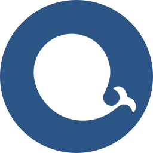
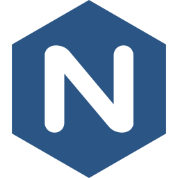
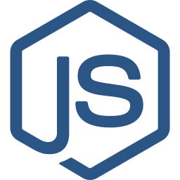
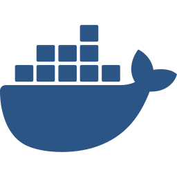
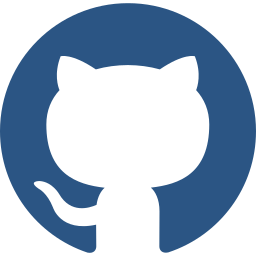
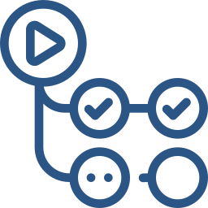

# The tech stack

| Who it is for | Reading time | Read first | Read next |
|---|---|---|---|
| Operators and developers | about 6 min | [Repository map](repository-map.md) | [The server](server.md) |

The portal is built from common, supported open-source parts, and nothing is installed inside Zabbix. This page names each part, shows its logo and says what it does here, so that whoever runs the portal can judge what it has to patch and support. The numbers are the major versions in the package files and the Dockerfiles.

The portal has no database. Every figure is read from Zabbix when it is asked for, kept in the server's memory for seconds to a day, and forgotten at a restart.

## In the browser

| Logo | Part | What it does here | Where |
|---|---|---|---|
|  | React 18 | Draws every page of the web app. | `web/` |
|  | React Router 7 | Moves between the pages without reloading. | `web/` |
|  | Apache ECharts 6 | Draws the graphs and the charts. | `web/` |
|  | TypeScript 5 | The one language of the app and the server. Types are checked before anything runs. | `web/`, `server/` |
|  | Vite 8 | Builds the app into the files that nginx serves, and runs the development server. | `web/` |

## In front of both

| Logo | Part | What it does here | Where |
|---|---|---|---|
|  | nginx 1.30 | Serves the app's files, passes every address that starts with `/bff` to the server, and sets the security headers. It runs unprivileged. | `web/` |

## On the server

| Logo | Part | What it does here | Where |
|---|---|---|---|
|  | Node.js 24 | Runs the server. | `server/` |
|  | Fastify 5 | The server's web framework: the routes, the check of each request, and the plugins for cookies, security headers, sign-in tokens and the rate limit. | `server/` |
| | Nodemailer 10 | Sends the monthly SLA report by email, when an administrator has switched that on. | `server/` |

## Where the data comes from

| Logo | Part | What it does here | Where |
|---|---|---|---|
|  | Zabbix 7.0 | The source of every figure. The portal reads its API over HTTPS with a read token, and writes once, to acknowledge or close a problem, with a separate token. | `server/` |

## The language model, which is optional

| Logo | Part | What it does here | Where |
|---|---|---|---|
|  | Claude | The hosted model behind Explain and the Assistant in the first copy, `hcml-portal`. | `server/` |
|  | Ollama | The model on the same machine behind the same two features in the second copy, `hcml-portal-ollama`. Nothing leaves the machine. | `server/` |

## Running it

| Logo | Part | What it does here | Where |
|---|---|---|---|
|  | Docker and Compose | Run the two containers of each copy, the server and the web server, read-only and without extra privileges. | `docker-compose.yml` |
|  | Alpine Linux | The small base of both container images. | `server/`, `web/` |

## Keeping it true

| Logo | Part | What it does here | Where |
|---|---|---|---|
|  | Vitest 5 | Runs the tests of the server and of the web app. | `server/`, `web/` |
|  | GitHub | Holds the repository of each copy. See [The GitHub repository](../3-integrations/github-repository.md). | `.github/` |
|  | GitHub Actions | Runs the checks on every push and pull request. See [GitHub and CI](../3-integrations/github-ci.md). | `.github/` |

## Why each layer is needed, and how soon to look after it

This table says what each layer is used for, why the portal cannot do without it, and when it needs someone's attention. The weekly and monthly rounds themselves are in [Run it](../4-working/run-it.md).

| Layer | Used for | Why it is needed | How soon to look after it |
|---|---|---|---|
| Browser app | The pages, the graphs and the forms that people use. | People open it. Without it the portal has no screens and is only a data service. | Each week, when Dependabot proposes package updates. A change goes live at the next rebuild, and a major release comes alone, to be read first. |
| Web server | Serves the app's files, passes every address that starts with `/bff` to the server, and sets the security headers. | It is the only part reachable from outside its containers, so it is the only door to the portal. The server stays behind it. | First in line, because it faces the network. The web image gets the system's updates at each month's first build, and Dependabot proposes a new base image each week. |
| Server | Reads Zabbix, checks who is asking, works out each answer and builds the report files. | It alone holds the Zabbix tokens and the signing secret, so the browser never sees them. | Soon after a security release of Node.js or Fastify. The base image is pinned by its digest and checked each month. |
| Data | Every figure the portal shows. | The portal keeps no data of its own, so it is only as good as what Zabbix holds. | On HCML's own schedule. The portal reads names that an upgrade can change, so each upgrade needs a retest, and there is no test Zabbix yet. |
| The language model | Explain and the Assistant: plain-language answers about problems and the SLA. | Optional. Without a model the portal works and the AI buttons hide. | The choice comes first and running it is not urgent. The hosted model sees host names and problem text, and the local model keeps everything on the machine. |
| Running it | Runs the two containers of each copy, starts them again and goes back. | One way to install it, to restart it and to go back to an earlier build. | Docker has to start by itself after a restart. On 31 October it did not, and both portals were down for about 37 hours. |
| Keeping it true | Proves each change with tests and checkers before a rebuild. | Nobody can read every line, so the tests say when a change broke something. | GitHub's checks have never run, because the account has a billing lock. The tests run in each copy until that is lifted. |

The logos are drawn in one colour from Simple Icons (CC0 1.0), and the Zabbix logo comes from Wikimedia Commons. Each name and logo belongs to its owner and is shown only to name the part.
