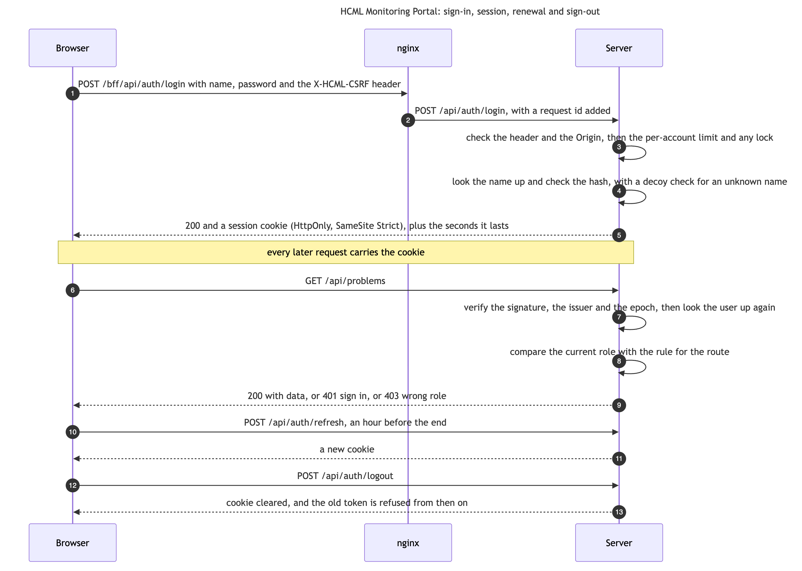

# Sign-in

| Who it is for | Reading time | Read first | Read next |
|---|---|---|---|
| Operators and developers | about 15 min | [nginx, Docker and TLS](nginx-docker-tls.md) | [Report files](reports-exports.md) |

## What it is for

Sign-in decides who may open the portal, what they may do and which pages they may see. There is no database and no identity provider: the accounts are kept in two places, the server's settings and a users file on the state volume, a session is a signed token in a cookie, and the server checks that token, and the role and the pages behind it, on every request to `/api`. The menu hides what a person cannot open, but that is a courtesy. The refusal is made by the server.

[Who can do what](../0-everyone/who-can-do-what.md) says what the three roles and the pages mean to a person. This page says how it is built. The reasons for keeping the users in a file of their own are in [decision record 17](../../architecture/adr/0017-keep-the-portals-users-in-a-file-of-their-own.md).

## The accounts

An account is a name, a password, a role and the pages it may open. They come from two places.

- **The settings.** `PORTAL_USERS` holds comma-separated triples of `name:password:role`. The name is what comes before the first colon and the role what comes after the last, so a password may hold colons, but not commas. The roles are `guest`, `operator` and `admin`. The two names the roles had before 17 November 2026 still read: `viewer` is a guest with the pages a viewer had, and `wall` is a guest who also has the Network and Links pages. An entry with a role the portal does not know is a guest, and a warning says so; an entry with no role is a guest too, without a warning. The warnings name an entry by its position, never by its text, so a malformed entry cannot put a password in the log. The first administrator among them is the break-glass account: it can always sign in, and only the settings change it.
- **The users file.** On a portal with a data folder (`PORTAL_STATE_DIR`, which both compose files set to the state volume), an administrator adds, changes and disables the other accounts on the Users page. They are kept in `users.json` on that volume: password hashes only, mode 0600, written whole and then renamed into place, with the version before the last change kept beside it as `users.json.prev`. A file that cannot be read is put aside as `users.json.broken-<time>` and never deleted. It is backed up with the state volume. The page says so when its connection is not encrypted: passwords typed there would travel in clear text, so the portal goes behind HTTPS before real accounts are added.

At every start the accounts of the settings other than the break-glass one are copied into the file by name, so that they can be managed on the page. A name the file already holds is not overwritten: from then on the file decides that person's password, role and pages, and the start says that the entry of the settings is ignored. Without a data folder nothing is kept: the accounts stay in the settings, and the Users page lists them to read only.

- A password is either plain text or a self-describing hash, which `server/scripts/hash-password.ts` makes: Argon2id (`argon2id.m.t.p.salt.hash`) since 18 November 2026, and the older `scrypt.N.r.p.salt.hash` still reads. It asks twice with the input hidden, or reads the password from standard input, never from an argument: pipe it in from a variable read without echo (`read -rs PW; printf '%s' "$PW" | npx tsx scripts/hash-password.ts; unset PW`), not from a command that holds the password as text, so that it stays out of the shell history. The cost settings travel with each hash, so raising them later leaves older entries working, and in the users file a sign-in rewrites a hash that is weaker than the settings of now. A hash holds no `:`, `,` or `$`, the three characters that would break the settings. The users file holds only hashes.
- When `PORTAL_USERS` holds at least one valid entry, `PORTAL_USER` and `PORTAL_PASS` are ignored. Those two are the single-admin shorthand, for a portal with one account, and that account is the break-glass one. So adding an operator entry beside a shorthand admin removes the admin from the settings, unless the admin is written into `PORTAL_USERS` too.
- Sign-in ignores the case of a name. A name listed twice in the settings can sign in with either entry, but its sessions are not renewed, because a token names its user and cannot say which entry it came from.
- The server refuses to start when an account of the settings has an empty password, the built-in `admin`, a plain password under 8 characters, or a hash it cannot read. It names the users and never the passwords. A password chosen on a page must have 8 to 256 characters and must not be on the short list of passwords that anyone can guess.

An account is looked up again on every request. Disable a user on the Users page, or let their expiry pass, and their session stops working on the next click. Change the role or the pages and that applies on the next click too, with no restart. An account of the settings is another matter: a removal or a change waits for a recreate of the server container (`docker compose up -d`; a plain restart keeps the old settings), because the settings are read once.

## Roles and pages

A role says what a person may do. A `guest` reads. An `operator` also acknowledges and closes problems. An `admin` also manages users and pages, reads the inventory scorecard, and sends or schedules the SLA report by mail.

A page of the menu is a module, and the modules say what a person may see. Each user has a list of their own, ticked on the Users page, and an administrator has every page. The preset of a role only fills in the ticks of a new user: what is stored is the user's own list, and nothing is looked up from the role afterwards, so changing a preset later changes nobody. A tick the role cannot use is not kept, because the inventory scorecard and the Users page are for administrators alone.

The server enforces the list on the API, not only in the menu. A route whose pages a person does not hold answers 403, and the Assistant is given only the parts of the estate that the person's own pages show, so a question cannot bring out what the person was not given.

## The session

A successful sign-in answers with the user and how many seconds the session lasts, and sets a cookie. The cookie is `HttpOnly`, so no script on the page can read it, and `SameSite=Strict`, so another site cannot make the browser send it. It is `Secure` only when the request arrived over HTTPS, which the server learns from `X-Forwarded-Proto`, since a browser drops a `Secure` cookie on plain HTTP. Its name is `SESSION_COOKIE`: `hcml_session` for the hosted copy and `hcml_session_ollama` for the other, so that two portals on one machine do not sign each other out.

The token is a signed JWT with the user's name, the role, the epoch, a unique id (`jti`), a session id (`sid`), and an issuer and audience taken from the cookie name, so a token minted by one copy is refused by the other. It lasts `SESSION_HOURS`, twelve by default, between two and twenty-four. A header `Authorization: Bearer` is accepted in place of the cookie, for scripts such as `tools/live/signedin_check.py`, and wins when both arrive.

- **Renewal.** An open page swaps its token for a new one an hour before it ends, with `POST /api/auth/refresh`, so a wall screen stays signed in for as long as its page is open. A closed tab renews nothing.
- **Sign-out.** `POST /api/auth/logout` clears the cookie and puts the token's session id on a list in memory, so every token of that sign-in, the ones a renewal gave included, is refused from then on, as a cookie or as an `Authorization: Bearer` header in any spelling: the id is taken from the verified token and never from the header text. The streams that session has open are closed at once. The list is kept for a whole session length, and a restart forgets it. What it does not end: a copy of a token that someone keeps renewing after the owner only closed the tab, without signing out. That copy works until the user is disabled on the Users page (or, for a user of `.env` alone, taken out of `PORTAL_USERS` and the container recreated), `SESSION_EPOCH` is raised and the server container recreated, or `JWT_SECRET` is changed. There is no absolute age on purpose, because a wall screen has to stay signed in. A sign-out that did not reach the server is not a sign-out: the page says so and stays, and the person presses the button again.
- **What the page learns.** `GET /api/auth/me` answers with the user, the seconds left, `pages` (the pages this account has, each with the role it needs, worked out from the same table that guards its route, so the menu keeps no copy of the rules) and `modules`. A page the account lacks is not in the menu, and typing its address shows a page that says so.
- **A temporary password.** A new user, or one whose password an administrator reset, must choose a new password first: `me` says `mustChange`, and nothing but choosing a new password works until it is chosen.
- **One's own password.** `POST /api/auth/password` takes the current password and a new one, ends the person's older sessions and answers with a fresh token, so the person stays signed in. A user of the settings changes the password in the settings.

## The guard

One `onRequest` hook covers every route under `/api` except five that are public: `/api/health`, `/api/auth/login`, `/api/auth/me`, `/api/auth/logout` and `/api/auth/request` (the form for an account, off unless `ACCOUNT_REQUESTS` is on, and the one public route that writes to disk). `/api/health` is public too, but a signed-in caller is told more.

For every other route the hook checks the signature, the issuer and the epoch, looks the user up again (a user who is disabled or past their expiry is refused as a bad token is), and asks the table of routes in `server/src/security/modules.ts` two things in this order: is the person's role high enough, and do they hold one of the pages that own the route. A route that no row names is for administrators only, so a new route is protected by default, and a test fails when a registered route has no row. The rows that matter most:

| Route | Needs |
|---|---|
| `/api/users` | the `admin` role |
| `/api/reports/inventory`, `/api/sli/email`, `/api/sli/schedule` and `/api/sli/recipients` | the `admin` role, and the page that owns them |
| `/api/problems/acknowledge` and `/api/problems/close` | the `operator` role, and the Problems page |
| `/api/net` | the Network page |
| `/api/links` | the Links page |
| every other read | the `guest` role, and one of the pages that use the route |

Ranks run guest, operator, admin, and a role may do what any lower rank may. Refusals have one shape: 401 `unauthorized` ("Sign in to continue."), 403 `forbidden` (a sentence that says which role the view needs, or which page the account does not have), and 403 `password_change_required` for a temporary password. `server/src/security/modules.ts` pairs each page of the menu with the route that fills it, and a test fails when the menu offers a page that has no module. `server/src/security/viewerPolicy.ts` closes one more gap: network interface data is for accounts that have the Network page even when it is read through a generic route such as the items list, the latest data or a graph.

The route is judged by the route the router matched, not by the raw text of the address, because the router decodes the path first and `/%61pi/hosts` reaches the `/api/hosts` handler.

## The cross-site check

A page on another site must not be able to make a signed-in browser acknowledge a problem. So every `POST`, `PUT`, `PATCH` or `DELETE` that the browser authenticates by itself, with the cookie, must carry the header `X-HCML-CSRF: 1`, and when it carries an `Origin`, that must be the `Host` the server received. Sign-in and sign-out are checked always. A script holding a Bearer token needs neither. CORS allows only `WEB_ORIGIN`, so another site's preflight for the custom header fails, and `X-HCML-CSRF` cannot be added without a preflight.

## The brakes on guessing

- **The overall limit.** `RATE_LIMIT_PER_MINUTE` (300) for one client address, counted before the guard, so a flood is counted before any token is verified. The live stream, the health check and sign-out are exempt, because a wall holds one connection and the others are polled on purpose.
- **Sign-in.** Ten attempts a minute for one account from one address. After ten failures in a row from one address for one account, the next sign-in is refused for a minute, and each further failure doubles the lock up to five minutes. A correct sign-in clears the count. The lock is short because everyone behind Docker's gateway shares one address.
- **The cost of a miss.** A name nobody holds still costs one hash check, so an unknown name is not quicker to refuse than a known one.
- **The log.** Every attempt is logged as `sign_in` with the account's name when an account holds it, or `unknown` and the length of what was typed when none does (so a password typed into the name box stays out of a log that lasts), the outcome and the address, never the password. Every fifth failure in a row for one name, from any address within fifteen minutes, logs a warning.
- **The body.** A name and a password fit in 4 KB, so a megabyte-long name cannot reach the limiter's memory.

## With sign-in off

`AUTH_ENABLED=false` is for development only. Every caller is an admin with every page but the Users page, since there are no accounts to manage, the host check answers only a `Host` that names this machine so that a rebinding page cannot reach the server, and acknowledge and close are refused unless `ALLOW_WRITE_WITHOUT_AUTH=true` is also set. Report email, the monthly schedule and the saved list of recipients are refused unless `ALLOW_EMAIL_WITHOUT_AUTH=true` is set (SC-43, SC-49), since every caller would be an administrator and could send the report to any address. Leave both unset.

## Settings

| Setting | Default | What it does |
|---|---|---|
| `AUTH_ENABLED` | `true` | Sign-in on or off |
| `JWT_SECRET` | none, and compose refuses to start without it | Signs the sessions. A value published in the repository, or under 32 bytes, stops the server. Each copy has its own |
| `PORTAL_USERS` | none | The accounts of the settings: `name:password-or-hash:role`, comma-separated, with the role `guest`, `operator` or `admin` (`viewer` and `wall` still read) |
| `PORTAL_STATE_DIR` | none, and both compose files set `/data` | Where the users file and the other small files are kept. Without it the Users page is read-only |
| `PORTAL_USER`, `PORTAL_PASS` | `admin`, none | The single-admin shorthand. An empty password, `admin` or a plain password shorter than 8 characters stops the server, and a `$` in one needs single quotes in `.env` |
| `SESSION_COOKIE` | `hcml_session`, or `hcml_session_ollama` | The cookie's name, which is also the token's issuer and audience |
| `SESSION_HOURS` | 12 | How long a session lasts, from 2 to 24 |
| `SESSION_EPOCH` | 1 | A label inside every token. Changing it ends every session |
| `ALLOW_WRITE_WITHOUT_AUTH` | unset | The development opt-in for the write |
| `ALLOW_EMAIL_WITHOUT_AUTH` | unset | The development opt-in for report email, the monthly schedule and the saved list of recipients |

## How it fails

| What you see | Cause | What to do |
|---|---|---|
| 401 on every call after a restart that changed the settings | `JWT_SECRET` or `SESSION_EPOCH` changed, so old tokens are refused | Sign in again |
| "Invalid username or password." for a right password | The entry holds a `:` or `,` in the wrong place, or the name differs by more than case | Check the entry, using a hash for anything complicated |
| "Too many failed sign-ins ... Retry in n s." | The lock | Wait. Check for a script that retries |
| 403 `csrf` | A missing `X-HCML-CSRF` header, or an `Origin` that is not the `Host` | A proxy that changes `Host`, or a script that forgot the header |
| The server will not start | An unsafe configuration | The log names the setting, and never prints a secret |
| A new operator entry locks the admin out | `PORTAL_USERS` replaced the shorthand | List the admin beside it, or sign in as an administrator of the users file |
| The Users page says the users are kept in `.env` and read only | There is no `PORTAL_STATE_DIR` | Set it, or start the portal with the compose files, which set it |
| A person sees fewer pages than they should | Their own list of pages | An administrator ticks the page on the Users page, and it applies on their next click |
| A person is asked for a new password before anything else | Theirs is a temporary one | They choose one on the page that opens |
| `users.json.broken-<time>` appears beside `users.json` | The file could not be read | The log says which file was used instead. Restore from the backup of the state volume, or check the last changes to the users |

## How to check it

`tools/live/signedin_check.py` signs in through nginx and checks health, readiness, both report downloads, the stream and the problem list, and, for an administrator, the email settings, the monthly schedule and the CSV report (`--expect-mail on` asks that email is set up and `off` that it is not). It takes the name and password from `PORTAL_USER` and `PORTAL_PASSWORD` in the environment of your own shell and never prints them. Run it after every rebuild, because the rebuild script cannot sign in.

## Where the code is

| What | File |
|---|---|
| The guard, the cookie, the limits, the cross-site check | `server/src/security/auth.ts` |
| The users and the file they are kept in | `server/src/security/accounts.ts`, `server/src/security/userStore.ts`, `server/src/services/userDirectory.ts` |
| The Users routes | `server/src/routes/users.ts`, `server/src/services/users.ts` |
| Hashing and checking passwords | `server/src/security/passwords.ts`, `server/scripts/hash-password.ts` |
| The roles, the pages and the table of routes | `server/src/security/modules.ts` |
| What an account without the Network page may not read | `server/src/security/viewerPolicy.ts` |
| The request schemas | `server/src/core/schemas.ts` |
| The browser side: the session timing, renewal and the 401 | `web/src/api/session.ts`, `web/src/features/shell/useSessionRenewal.ts`, `web/src/shared/hooks/useAuth.ts` |
| The Users page, the account page and the forced change of a password | `web/src/features/users/`, `web/src/features/auth/` |
